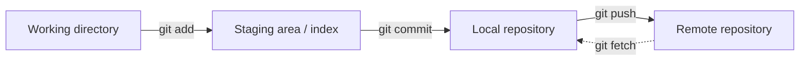
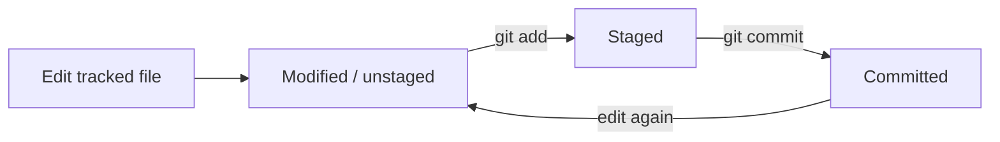
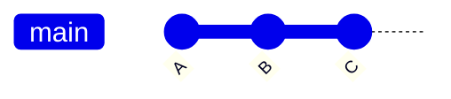
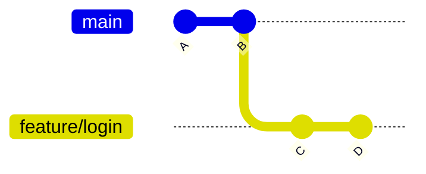
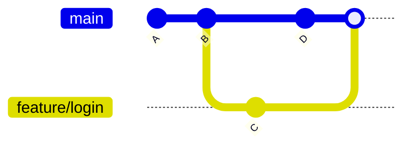

# Git & GitHub — Hour 1 Visual Notes

**Goal:** Understand Git's mental model, commits, HEAD, branches and merges. **Environment:** Windows PowerShell.

## 1. Git vs GitHub

Git is distributed version control on your computer; GitHub hosts repositories and adds collaboration (PRs, issues, reviews, Actions). A commit is local until pushed.

## 2. Four areas

Working tree: editable files. Index/staging: exact changes chosen for next commit. Local repository (.git): objects, commits and references. Remote: optional repository on GitHub or another server.



## 3. File states

Untracked: not in Git. Tracked/unchanged: matches index. Modified: working file differs from index. Staged: index differs from HEAD. A file can have both staged and unstaged changes.



## 4. What is a commit?

A commit identifies a tree snapshot, parent commit(s), author/committer information and message. Git hashes objects. A branch is a movable reference to a commit, not a duplicate directory.

## 5. HEAD and history

HEAD usually refers to the checked-out branch. The branch refers to a commit. HEAD~1 means first parent, HEAD~2 means first parent twice. In detached HEAD, HEAD directly refers to a commit.



`HEAD -> main -> C` when main is checked out at C.

## 6. Branching

Use feature branches to isolate work. git switch -c feature/login creates and checks out a branch; git switch main returns to main. Committing advances only the current branch.



## 7. Fast-forward merge

If main is an ancestor of feature/login, merging can simply move main to the feature tip. No merge commit is required.

## 8. Three-way merge

When both branches advanced, Git compares the merge base with each branch tip and combines changes. A merge commit normally has two parents. Overlapping incompatible edits can cause conflicts.



## 9. Safety and good habits

Run git status before staging and committing. Inspect git diff and git diff --staged. Do not commit .env, credentials, .venv, generated files or large model checkpoints. Use gitignore before files are tracked.

## Essential commands

| Command | Why |
|---|---|
| `git --version` | Check installation |
| `git init -b main` | Initialize repository |
| `git status` | Inspect state |
| `git add README.md` | Stage selected file |
| `git diff` | Unstaged tracked changes |
| `git diff --staged` | Staged changes |
| `git commit -m "docs: add notes"` | Commit staged snapshot |
| `git log --oneline --graph --decorate --all` | Inspect commit graph |
| `git show HEAD` | Inspect current commit |
| `git branch` | List local branches |
| `git switch -c feature/login` | Create and switch branch |
| `git switch main` | Switch to main |
| `git merge feature/login` | Merge feature into current branch |
| `git branch -d feature/login` | Delete merged local branch |

## Guided PowerShell lab (run in order)

```powershell
cd $HOME
mkdir git-hour1-lab
cd git-hour1-lab
git init -b main
Set-Content README.md "# Git Hour 1"
git status
git add README.md
git diff --staged
git commit -m "docs: initial README"
New-Item -ItemType Directory -Path notes
Set-Content notes/basics.md "# Basics"
git add notes/basics.md
git commit -m "docs: add basics notes"
Add-Content README.md "Learning Git visually."
git diff
git add README.md
git diff --staged
git commit -m "docs: update README"
git log --oneline --graph --decorate --all
git switch -c feature/login
New-Item -ItemType Directory -Path src
Set-Content src/login.py 'print("Login placeholder")'
git add src/login.py
git commit -m "feat: add login placeholder"
git switch main
git merge feature/login
git log --oneline --graph --decorate --all
git branch -d feature/login
```

**What to observe:** `src/login.py` disappears when switching back to `main` before merging, then appears after merging. The merge should be a fast-forward if main did not advance.

## 10-minute self-test

1. Explain why `git add` is not the same as `git commit`.
2. Explain why `git commit` does not upload to GitHub.
3. Stage a change, then edit the file again. What do `git diff` and `git diff --staged` show?
4. Explain `HEAD`, branch, commit and hash.
5. Make a feature branch, commit a new file, switch to main, and merge.
6. Why was your merge fast-forward rather than three-way?

## Mistakes to avoid

- `git add .` without checking `git status` and `git diff`.
- Assuming `.gitignore` removes already-tracked files.
- Committing `.env` or API keys. Rotate leaked keys immediately.
- Deleting the `.git` folder.
- Using `git branch -D` when you mean the safer `-d`.

## Quick interview answers

**What is HEAD?** The current checkout reference, normally a symbolic reference to a branch.  
**What is a branch?** A movable reference to a commit.  
**What is a fast-forward merge?** Moving the target branch pointer forward when no divergence exists.  
**What is a merge commit?** A commit combining histories, normally with two parents.  
**What is the index?** Git's staging area, representing the proposed next snapshot.

**Next:** Hour 2 — remotes, collaboration, merge conflicts, rebase and pull requests.
