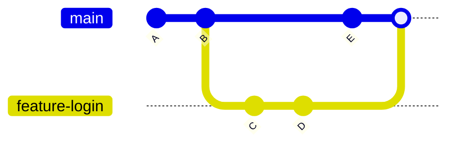

# Hour 2 — Branching, Merging, Conflicts & Rebase

## 1. Branches
A branch is a movable pointer to a commit.

```bash
git branch
git switch -c feature/login
git switch main
git branch -d feature/login
```

## 2. Branching Diagram



## 3. Fast-forward Merge
When main is an ancestor of the feature branch, Git can simply advance main.

```bash
git switch main
git merge feature/login
```

## 4. Three-way Merge
Combines two diverged histories using a common ancestor. Usually creates a merge commit.

```bash
git merge --no-ff feature/login
```

## 5. Merge Conflicts
A conflict occurs when Git cannot automatically reconcile changes.

Conflict markers:
- <<<<<<< HEAD : current side
- ======= : separator
- >>>>>>> feature : incoming side

Resolution:
1. Open conflicting files.
2. Decide which changes to keep.
3. Remove conflict markers.
4. Run git add.
5. Run git merge --continue.

Abort an unresolved merge:
```bash
git merge --abort
```

## 6. Rebase vs Merge
Merge preserves existing histories.
Rebase replays commits onto a new base and rewrites commit IDs.

```bash
git switch feature/login
git rebase main
git rebase --continue
git rebase --abort
```

Avoid rebasing shared published commits without coordination.

## 7. Remote Branches
```bash
git remote -v
git fetch origin
git pull --ff-only origin main
git push -u origin feature/login
git branch -r
```

## 8. Professional Workflow
1. Update main.
2. Create a feature branch.
3. Make focused commits.
4. Push feature branch.
5. Open pull request.
6. Review and run CI.
7. Merge into main.
8. Delete merged feature branch.

## 9. Common Mistakes
- Merging into the wrong branch.
- Resolving conflicts without testing.
- Rebasing shared commits.
- Force-pushing main.
- Assuming git push merges a feature branch.

## 10. Interview Questions
1. What is a branch?
2. Fast-forward vs three-way merge?
3. Why do merge conflicts occur?
4. How do you resolve a merge conflict?
5. Merge vs rebase?
6. What does git merge --abort do?
7. Local branch vs remote-tracking branch?
8. What does git push -u do?
